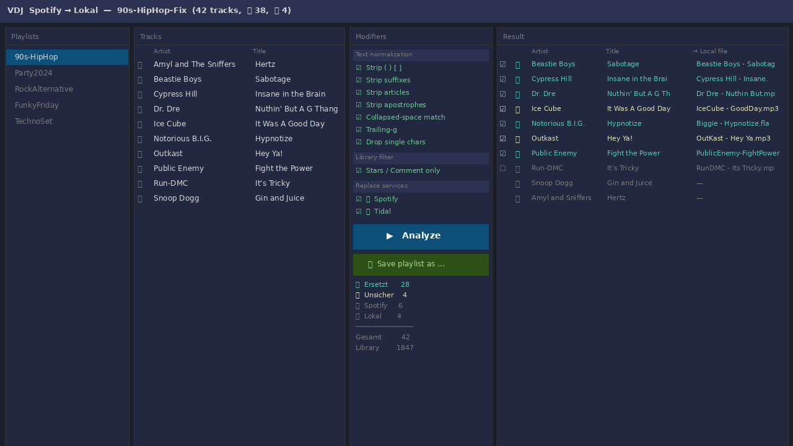

# VirtualDJ Playlist Destreamer

Replaces Spotify / Tidal tracks in a VirtualDJ playlist with locally owned copies — without touching your original files.



---

## What it does

VirtualDJ stores playlists (`.vdjfolder`) as XML files. When you've been mixing from Spotify or Tidal and later buy or rip those albums, this tool finds the matches in your local library and produces a **new** playlist with the streaming entries swapped out for the local files.

- Scans your `MyLists/*.vdjfolder` playlists
- Matches Spotify / Tidal tracks against your `database.xml` using fuzzy title + artist normalization
- Lets you **toggle** each match on/off before saving
- Writes a new `.vdjfolder` — your originals are never modified
- Handles umlauts, parenthetical suffixes, articles, apostrophes, trailing-g variations, and single-character noise

---

## Requirements

- **macOS** (paths default to `~/Library/Application Support/VirtualDJ`)
- **Python 3.10+ with Tk 8.6** — see note below
- **VirtualDJ** with a populated `database.xml`
- Optional: [`mutagen`](https://pypi.org/project/mutagen/) for deeper local-track detection via embedded tags

> **⚠️ macOS Python / Tk note**
>
> The **system Python** shipped with macOS (at `/Library/Developer/CommandLineTools/…`) uses Apple's deprecated Tk 8.5, which does not render the UI correctly. You need a Python installation that bundles Tk 8.6+:
>
> **Option A — Homebrew (recommended):**
> ```bash
> brew install python-tk@3.13
> ```
> Then use `python3.13` when creating your venv (see below).
>
> **Option B — python.org installer:**
> Download the macOS package from [python.org/downloads](https://www.python.org/downloads/macos/) — it includes Tcl/Tk 8.6 out of the box.

---

## Installation & running (venv)

```bash
# 1. Clone
git clone https://github.com/andymann/virtualdj-playlist-destreamer.git
cd virtualdj-playlist-destreamer

# 2. Create and activate a virtual environment
#    macOS: use python3.13 (Homebrew) or the python.org installer, NOT the system Python
#    See the macOS note above if you get an empty window.
python3.13 -m venv .venv          # macOS with Homebrew python-tk
# python3 -m venv .venv           # Linux / macOS python.org installer
source .venv/bin/activate

# 3. Install optional dependency (recommended)
pip install mutagen

# 4. Run
python vdj_spotify_ui.py
```

To launch again later:

```bash
cd virtualdj-playlist-destreamer
source .venv/bin/activate
python vdj_spotify_ui.py
```

> **Note:** Close VirtualDJ before saving a playlist, otherwise VDJ will overwrite your new file on exit.

---

## Building a standalone binary (optional)

Use [PyInstaller](https://pyinstaller.org) to create a self-contained executable — no Python installation required on the target machine.

```bash
# 1. Activate the venv (must be the python3.13 / proper-Tk venv)
source .venv/bin/activate

# 2. Verify Tk 8.6 is bundled (should print 8.6, not 8.5)
python -c "import tkinter; print(tkinter.TkVersion)"

# 3. Install PyInstaller
pip install pyinstaller

# 4a. Single-file binary (no window, terminal hidden)
pyinstaller --onefile --windowed vdj_spotify_ui.py
# → dist/vdj_spotify_ui

# 4b. macOS .app bundle (drag-and-drop to Applications)
pyinstaller --onefile --windowed --name "VDJ Destreamer" vdj_spotify_ui.py
# → dist/VDJ Destreamer.app
```

> **Note:** PyInstaller bundles the Python and Tk from the active venv. Make sure you are in the `python3.13` (Homebrew or python.org) venv — otherwise the broken macOS system Tk ends up in the binary.

---

## How to use

1. **Pick a playlist** from the left panel — tracks load automatically.
2. **Adjust modifiers** in the middle panel (defaults work well for most libraries).
3. Click **▶ Analyze** — the Result panel shows every track with its match status:
   - ✅ Green = confident local match
   - 🟡 Yellow = fuzzy match (artist word overlap only) — review these
   - 🎵 = no local copy found / service not selected for replacement
   - 💿 = already a local file, kept as-is
4. **Click any matched row** to toggle it off (☐) if you don't want that substitution.
5. Click **💾 Save playlist as …**, enter a name, and the new `.vdjfolder` lands in `MyLists/`.
6. Restart VirtualDJ — the new playlist appears in your browser.

---

## Modifier options

| Option | Effect |
|---|---|
| Strip `( ) [ ]` | Removes parenthetical suffixes before matching |
| Strip suffixes | Drops "Remastered", "Radio Edit", "Live", etc. |
| Strip articles | Ignores "The", "Der", "Les", … |
| Strip apostrophes | `it's` → `its` |
| Collapsed-space match | `hiphop` matches `hip hop` |
| Trailing-g | `dancin'` matches `dancing` |
| Drop single chars | Removes stray single-character tokens |
| Stars / Comment only | Only considers DB tracks that have a star rating or comment (faster, fewer false positives) |
| 🎵 Spotify / 🌊 Tidal | Choose which services to replace |

---

## Local track detection

A track counts as "local" if its `database.xml` entry has:
- A real file path (not a `netsearch://` or `.vdjcache` path)
- No `netsearchId` attribute (streaming tracks VDJ cached with metadata)
- With **Stars / Comment only** enabled: at least one star or a comment tag

---

## License

MIT
